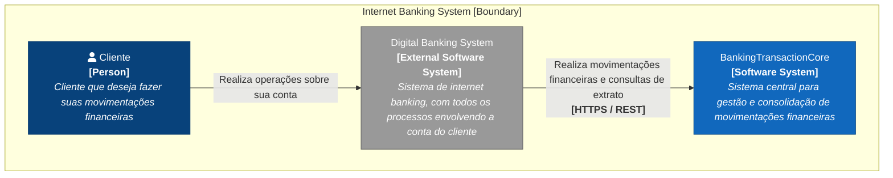
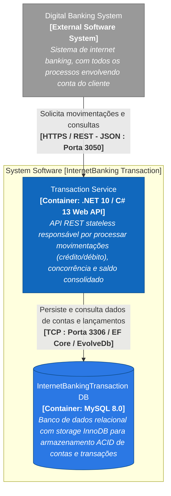
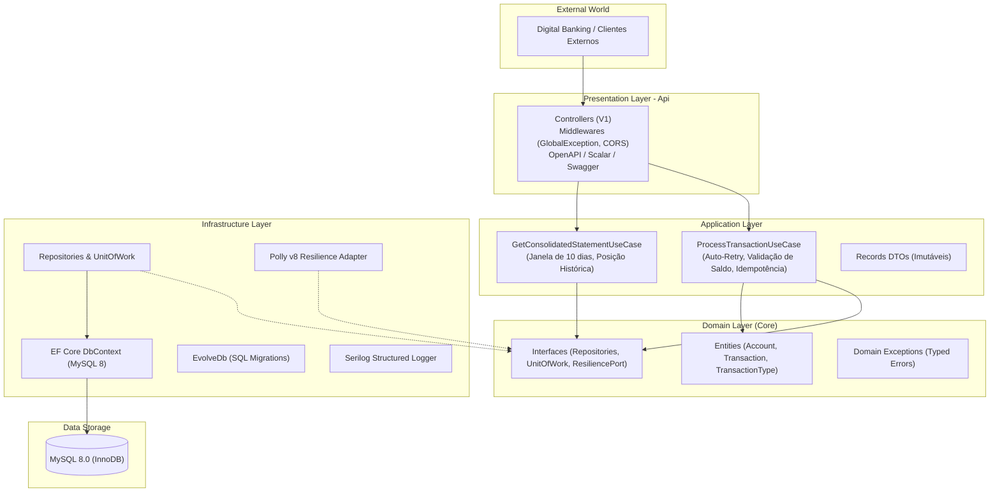
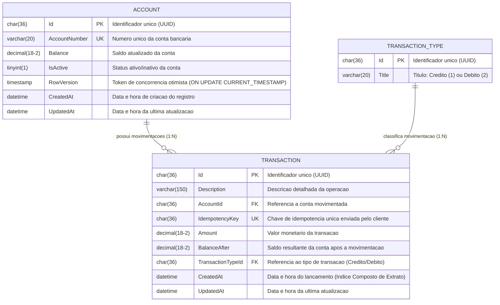
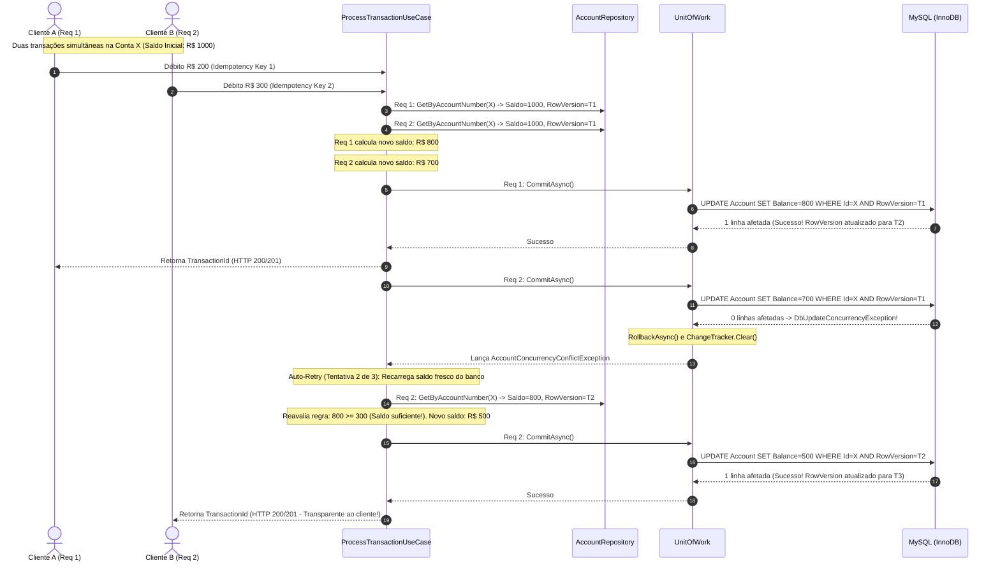

# Challenge Banking Transaction Core API (.NET 10)

[](https://dotnet.microsoft.com/)
[](https://learn.microsoft.com/dotnet/csharp/)
[](https://www.mysql.com/)
[](https://evolve-db.netlify.app/)
[](https://github.com/App-vNext/Polly)
[](https://testcontainers.com/)
[](https://scalar.com/)

Microsserviço bancário de alta performance e resiliência responsável pelo registro transacional de movimentações financeiras (crédito e débito) e pela consolidação de saldos e extratos históricos ao longo do tempo. 

Desenvolvido sob os preceitos de **C4 Model**, **Clean Architecture**, **Domain-Driven Design (DDD)**, **Concorrência Otimista com Auto-Retry**, **Idempotência Estrita** e **Resiliência Transacional**.

---

## 1. Scorecard de Conformidade e Critérios Eliminatórios

| Critério Eliminatório / Arquitetural | Status | Evidência Técnica |
| :--- | :---: | :--- |
| **Linguagem & Framework** | **Conforme (100%)** | Desenvolvido integralmente em **C# 13 / .NET 10**. |
| **Ausência de Warnings e Erros** | **Conforme (100%)** | Compilação com **0 Warnings** e **0 Errors** em todos os projetos. |
| **Testes Automatizados** | **Conforme (100%)** | 46 testes aprovados (38 unitários + 8 integração com Testcontainers MySQL). |
| **Concorrência & Consistência ACID** | **Conforme (100%)** | Concorrência Otimista (`RowVersion`) + Auto-Retry transparente (3 tentativas) + Fallback HTTP 409 Conflict. |
| **Posição Consolidada no Tempo** | **Conforme (100%)** | Busca indexada $O(\log N)$ no MySQL (`IX_Transaction_AccountId_CreatedAt`) + proteção contra sobrecarga via janela de 10 dias. |
| **Modelagem C4 & DER Completo** | **Conforme (100%)** | C4 Context, C4 Container, C4 Component (Clean Architecture) e Diagrama Entidade-Relacionamento (DER). |
| **Execução Local Descomplicada** | **Conforme (100%)** | Orquestração completa via Docker Compose e script automatizado `devops.sh`. |
| **Documentação no Repositório** | **Conforme (100%)** | Documentação técnica, arquitetura, diagramas Mermaid e contratos integrados no repositório. |

---

## 2. Desenho Arquitetural e Modelagem Visual

A modelagem arquitetural da solução adota a metodologia **C4 Model** (Contexto, Contêineres e Componentes) integrada ao **Diagrama Entidade-Relacionamento (DER)** da persistência relacional.

### 2.1 C4 Model — Nível 1: Diagrama de Contexto de Sistema (System Context)

Apresenta os usuários do ecossistema bancário, os limites do sistema e as integrações de alto nível com canais e plataformas clientes.



---

### 2.2 C4 Model — Nível 2: Diagrama de Contêineres (Containers)

Evidencia os contêineres de software desacoplados, protocolos de comunicação, portas e papéis de processamento e persistência.



---

### 2.3 C4 Model — Nível 3: Diagrama de Componentes (Clean Architecture)

A aplicação interna do microsserviço adota a **Clean Architecture**, isolando o domínio e os casos de uso de quaisquer dependências externas.



#### Responsabilidade dos Projetos:
- **`Api` (`ChallengeBankingTransactionCore.Service.Api.Transaction`):** Controladores REST, middleware de erro global RFC 7807, CORS restritivo e renderização OpenAPI/Scalar.
- **`Application` (`ChallengeBankingTransactionCore.Service.Application.Transaction`):** Casos de uso desacoplados (`ProcessTransactionUseCase`, `GetConsolidatedStatementUseCase`), regras de concorrência com auto-retry e DTOs imutáveis (Records).
- **`Domain` (`ChallengeBankingTransactionCore.Service.Domain.Transaction`):** Entidades puras com invariantes (`Account`, `Transaction`), interfaces de portas (`IAccountRepository`, `ITransactionRepository`, `IUnitOfWork`, `IResiliencePolicyExecutorPort`) e catálogo de exceções tipadas.
- **`Infrastructure` (`ChallengeBankingTransactionCore.Service.Infrastructure.Transaction`):** Persistência relacional com EF Core, transações atômicas no `UnitOfWork`, migrações determinísticas EvolveDb e adaptadores Polly v8.
- **`Tests` (`ChallengeBankingTransactionCore.Service.Api.Transaction.Tests`):** Testes unitários com Moq e testes de integração com banco real via Testcontainers MySQL.

---

### 2.4 Diagrama Entidade-Relacionamento (DER)

Estrutura de dados relacional executada no MySQL 8.0 (InnoDB) com tipos estritos, chaves primárias UUID v4, chaves estrangeiras, token de concorrência e índices de performance:



#### Destaques dos Índices e Constraints do Banco de Dados:
1. **`PK_Account` & `PK_Transaction`:** Chaves primárias UUID formatadas em `CHAR(36)` garantindo unicidade global sem dependência de sequências de auto-incremento.
2. **`UQ_Account_AccountNumber`:** Índice único impedindo a existência de contas duplicadas.
3. **`UQ_Transaction_IdempotencyKey`:** Constraint única no banco que blinda a API contra lançamentos repetidos da mesma requisição financeira.
4. **`IX_Transaction_AccountId_CreatedAt` (B-Tree Composto):** Índice criado pela migração `V6` ordenado por `(AccountId, CreatedAt DESC)` para viabilizar consultas de posição consolidada no tempo em **$O(\log N)$** sem *table scans*.
5. **`RowVersion` (`TIMESTAMP`):** Atualizado automaticamente pelo motor InnoDB a cada alteração, servindo de base para o controle de concorrência otimista.

---

## 3. Decisões Arquiteturais e Resiliência (ACID)

### 3.1 Concorrência Otimista com Auto-Retry Transparente

Para evitar contenção de banco e riscos de deadlock sob concorrência massiva na mesma conta (ex.: múltiplos débitos e créditos simultâneos), rejeitou-se o bloqueio pessimista (`SELECT ... FOR UPDATE`) em favor da **Concorrência Otimista**:

1. A entidade `Account` mapeia a propriedade `RowVersion` com a anotação `[ConcurrencyCheck]`. No MySQL, a coluna é do tipo `TIMESTAMP` configurada com `DEFAULT CURRENT_TIMESTAMP ON UPDATE CURRENT_TIMESTAMP`.
2. Quando dois processos tentam alterar o saldo simultaneamente, o primeiro persiste com sucesso e atualiza a estampa temporal da linha. O segundo gera uma colisão (`DbUpdateConcurrencyException`).
3. O `UnitOfWork` intercepta essa exceção, aborta a transação (`RollbackAsync`), limpa completamente o rastreador de instâncias (`_context.ChangeTracker.Clear()`) para expurgar dados em cache e encapsula o evento em uma exceção de domínio tipada: `AccountConcurrencyConflictException`.
4. O caso de uso (`ProcessTransactionUseCase`) captura o conflito e executa um **Auto-Retry com Reload** (até 3 tentativas com backoff progressivo):
   - Recarrega o saldo fresco e o novo `RowVersion` diretamente do banco.
   - Reavalia as regras de negócio: se for um débito e o saldo fresco ficou insuficiente após o lançamento concorrente, aborta imediatamente com **HTTP 422 Unprocessable Entity** (`InvalidValueToDebitError`).
   - Se o saldo ainda for suficiente, reaplica a operação e comita com sucesso.
   - Caso a colisão persista após 3 tentativas sob contenção extrema, responde com **HTTP 409 Conflict**, eliminando qualquer possibilidade de vazamento de HTTP 500 para o cliente.



### 3.2 Posição Consolidada no Tempo ($O(\log N)$) e Proteção de Janela

Para responder à exigência de consultar a posição de saldo consolidado em um momento determinado:
- **Índice Composto no MySQL (`IX_Transaction_AccountId_CreatedAt`):** A migração `V6` criou o índice `(AccountId, CreatedAt DESC)`. A recuperação do saldo histórico na data de corte é feita em tempo logarítmico sub-milissegundo via `GetBalanceAtDateAsync`, buscando diretamente o `BalanceAfter` da última transação ocorrida antes ou no momento exato do corte.
- **Proteção Contra Sobrecarga (Janela de 10 Dias):** Consultas sem limites temporais causam *full-table scans* catastróficos em bancos de alta volumetria. O caso de uso `GetConsolidatedStatementUseCase` aplica uma janela máxima padronizada de 10 dias (projetando para frente ou para trás caso apenas uma data seja enviada) e valida a coerência temporal (`StartDate <= EndDate`), retornando `InvalidDateRangeException` (HTTP 422) se as datas forem inconsistentes.
- **Payload Rico:** O retorno informa o `consolidatedBalance` na data solicitada, o `currentBalance` atual da conta, a `referenceDate` efetiva da consulta e cada lançamento contendo seu próprio `balanceAfter`.

### 3.3 Idempotência Estrita

- O registro de movimentação aceita uma `idempotencyKey` opcional enviada pelo cliente (se nula, é gerada via UUID v4).
- O banco possui constraint de unicidade (`UNIQUE KEY UQ_Transaction_IdempotencyKey`).
- Antes de processar, o caso de uso consulta se a chave já existe (`GetByIdempotency`). Em caso afirmativo, devolve imediatamente o identificador da transação pré-existente sem alterar saldos e sem reprocessamento.

### 3.4 Resiliência de Infraestrutura com Polly v8

- Implementada via `PollyResiliencePolicyExecutorAdapter` utilizando a moderna API `ResiliencePipelineBuilder`.
- Estratégia de Retry com Backoff e Jitter (3 tentativas, intervalo de 2s) para falhas transitórias de comunicação com o MySQL, prevenindo indisponibilidade parcial sob rajadas de rede.

### 3.5 Migrações Determinísticas com EvolveDb

- Migrações SQL puras em `Database/Migrations` (versionadas de `V1` a `V6`) e massa de dados determinística para desenvolvimento em `Database/Dataset`.
- Execução automática e idempotente na inicialização da API, eliminando discrepâncias entre ambientes.

---

## 4. Como Rodar a Aplicação Localmente

### Pré-requisitos
- [Docker](https://www.docker.com/) e Docker Compose instalados e em execução.
- (Opcional para execução nativa fora de contêineres) [.NET 10 SDK](https://dotnet.microsoft.com/download/dotnet/10.0).

---

### Opção 1: Execução Automática via Script DevOps (Recomendado)

O repositório inclui o script utilitário `devops.sh` que gerencia a rede Docker, o contêiner do MySQL 8 e a compilação/subida da API:

```bash
# 1. Garanta permissão de execução (Linux / macOS)
chmod +x devops.sh

# 2. Suba a infraestrutura completa (MySQL + API)
./devops.sh dev up
```

Após a inicialização:
- **API Base:** `http://localhost:3050`
- **Documentação Interativa Scalar:** `http://localhost:3050/scalar/v1`
- **Documentação Swagger UI:** `http://localhost:3050/swagger`
- **Banco MySQL (Exposto):** Porta `3307` | Usuário: `root` | Senha: `@admin123` | Database: `ChallengeBankingTransactionCore_Transaction_IntegrationTestDb`

#### Comandos Úteis do Script:
```bash
./devops.sh dev logs     # Exibir logs em tempo real dos contêineres
./devops.sh dev build    # Recompilar a imagem Docker da API
./devops.sh dev down     # Parar os serviços mantendo os dados do MySQL preservados
```

---

### Opção 2: Execução Direta via Docker Compose

Caso prefira operar sem o script auxiliar:

```bash
# 1. Criar a rede Docker externa exigida pela arquitetura
docker network create ChallengeBanking_network_dev

# 2. Subir os contêineres compilando a aplicação
docker compose -f docker-compose.yml -f docker-compose-dev.yml up -d --build
```

---

### Opção 3: Execução Híbrida (MySQL no Docker + API via CLI .NET)

Se desejar depurar ou executar a API diretamente em sua IDE (.NET 10):

```bash
# 1. Subir apenas o contêiner do banco de dados MySQL
docker compose -f docker-compose.yml -f docker-compose-dev.yml up -d mysql

# 2. A partir da pasta Api, restaurar e rodar o projeto da API
dotnet restore ChallengeBankingTransactionCore.slnx
dotnet run --project src/ChallengeBankingTransactionCore.Service.Api.Transaction/ChallengeBankingTransactionCore.Service.Api.Transaction.csproj
```

---

## 5. Como Executar a Suíte de Testes Automatizados

A solução conta com **46 testes automatizados** cobrindo cenários felizes, validações de domínio, limites temporais, concorrência e integridade em banco real.

```bash
# Executar toda a suíte de testes (Unitários + Integração)
dotnet test

# Executar exclusivamente testes unitários (Rápidos, sem dependência de Docker)
dotnet test --filter "FullyQualifiedName~Unit"

# Executar testes de integração (Sobe contêiner MySQL efêmero via Testcontainers)
dotnet test --filter "FullyQualifiedName~IntegrationTests"
```

### Cobertura dos Testes:
- **Testes Unitários (38 testes):**
  - `ProcessTransactionUseCaseTests`: Débito, crédito, validações de saldo insuficiente, idempotência ativa, recuperação transparente via Auto-Retry na 2ª tentativa, esgotamento de retries com HTTP 409 e tratamento de saldo insuficiente durante colisão com HTTP 422.
  - `GetAccountBalanceUseCaseTests`: Janelas padrão de 10 dias, projeções unilaterais, consultas com datas retroativas e bloqueio de data inicial superior à data final.
  - `Domain & Infrastructure Tests`: Invariantes de entidades, adapters Polly e formatadores.
- **Testes de Integração (8 testes):**
  - Validação end-to-end com MySQL real gerenciado via Testcontainers.
  - Verificação de persistência, constraints de chave única e migrações EvolveDb.

---

## 6. Endpoints Principais e Exemplos de Uso

### 6.1 Registrar Transação (Crédito ou Débito)
Registra uma operação financeira em uma conta bancária de forma atômica e idempotente.

- **Método / Rota:** `POST /api/transaction/v1`
- **Content-Type:** `application/json`

#### Exemplo de Requisição (Débito):
```json
{
  "accountNumber": "12345-6",
  "value": 150.00,
  "transactionType": 2,
  "idempotencyKey": "9b1deb4d-3b7d-4bad-9bdd-2b0d7b3dcb6d"
}
```
> *Observação:* `transactionType`: `1` = Crédito, `2` = Débito. O campo `idempotencyKey` é opcional (gerado automaticamente caso omitido).

#### Códigos de Retorno:
| HTTP Status | Significado | Exemplo de Causa |
| :---: | :--- | :--- |
| **200 / 201** | Sucesso | Transação processada. Retorna o ID da movimentação. |
| **403** | Forbidden | Violação de política de CORS ou canal não autorizado. |
| **404** | Not Found | Conta informada não foi localizada. |
| **409** | Conflict | Concorrência extrema esgotada após 3 retries transparentes. |
| **422** | Unprocessable Entity | Saldo insuficiente para débito ou valor transacionado inválido. |

---

### 6.2 Consultar Extrato e Posição Consolidada no Tempo
Retorna a relação de lançamentos dentro de um intervalo protegido (máximo de 10 dias) e o saldo consolidado na data de referência informada.

- **Método / Rota:** `GET /api/consolidatedstatement/v1`
- **Parâmetros de Query:**
  - `accountNumber` (string, obrigatório): Número da conta.
  - `startDate` (DateTime, opcional): Data inicial (ISO 8601).
  - `endDate` (DateTime, opcional): Data final de corte (ISO 8601).

#### Exemplo de Requisição:
```http
GET /api/consolidatedstatement/v1?accountNumber=12345-6&startDate=2026-11-01T00:00:00Z&endDate=2026-11-10T23:59:59Z HTTP/1.1
Host: localhost:3050
```

#### Exemplo de Resposta:
```json
{
  "accountNumber": "12345-6",
  "consolidatedBalance": 850.00,
  "currentBalance": 1200.00,
  "referenceDate": "2026-11-10T23:59:59Z",
  "consolidatedTransactions": [
    {
      "amount": 1000.00,
      "createdAt": "2026-11-02T10:15:30Z",
      "transactionType": "Credit",
      "balanceAfter": 1000.00
    },
    {
      "amount": 150.00,
      "createdAt": "2026-11-05T14:22:10Z",
      "transactionType": "Debit",
      "balanceAfter": 850.00
    }
  ]
}
```

---

## 7. Segurança e Proteção de Dados

1. **Proteção de Dados em Repouso e Trânsito:** Configurado via `builder.Services.AddDataProtection()`.
2. **CORS Restritivo:** Bloqueio ativo de origens não autorizadas com retorno HTTP 403.
3. **Isolamento de Segredos:** Credenciais sensíveis e connection strings são injetadas estritamente via variáveis de ambiente (`ASPNETCORE_` / `ConnectionStrings__`), sem dados sigilosos versionados no código.
4. **Resistência a SQL Injection:** Uso exclusivo de consultas parametrizadas via Entity Framework Core e migrações tipadas.

---

## 8. O Que Faria Diferente com Mais Tempo (Trade-offs e Arquitetura Corporativa)

Em um cenário corporativo de altíssima escala bancária (centenas de milhares de transações simultâneas por segundo), a arquitetura seria evoluída nas seguintes frentes:

1. **Arquitetura Orientada a Eventos (EDA) com Particionamento por Conta:**
   - Para erradicar contenção em banco relacional sob rajadas simultâneas na mesma conta, utilizaríamos um broker de mensageria (Apache Kafka ou RabbitMQ com Consistent Hashing Exchange) particionado pela chave `AccountId`.
   - Todas as operações financeiras da mesma conta entrariam na mesma partição de tópicos de forma serializada em memória, garantindo ordenação perfeita com throughput de centenas de milhares de TPS sem locks em banco relacional.
2. **Transactional Outbox Pattern:**
   - Para publicação atômica de eventos de domínio (ex.: `TransactionRegisteredEvent`) para mensageria no mesmo commit do banco relacional, garantindo entrega do tipo *at-least-once* sem risco de inconsistência em caso de falha de rede.
3. **CQRS com Segregação Física de Leitura:**
   - Como consultas de extrato e saldo possuem volumetria muito superior à de escrita, segregaríamos um Read Model desacoplado utilizando réplicas de leitura (*MySQL Read Replicas*) ou cache chave-valor ultra-rápido (*Redis*) para o saldo consolidado atualizado por streams de Change Data Capture (Debezium/Kafka).
4. **Observabilidade Distribuída (OpenTelemetry):**
   - Instrumentação nativa com métricas de negócio (TPS, taxa de colisão de concorrência, latência $P_{99}$), exportação de traces distribuídos com Jaeger/Tempo e métricas Prometheus para dashboards Grafana.
5. **Rate Limiting Nativo por IP e Conta:**
   - Implementação de middleware de rate limiting nativo do ASP.NET Core (`AddRateLimiter`) com algoritmo *Token Bucket* ou *Fixed Window* para conter tentativas de força bruta ou ataques de negação de serviço distribuídos.

---

## 9. Estrutura do Repositório

```text
Api/
├── ChallengeBankingTransactionCore.slnx   # Arquivo de Solução moderno .NET
├── Dockerfile                             # Build multi-stage otimizado
├── docker-compose.yml                     # Definição base de contêineres
├── docker-compose-dev.yml                 # Configurações de desenvolvimento e rede
├── devops.sh                              # Script utilitário de automação local
├── src/
│   ├── ChallengeBankingTransactionCore.Service.Api.Transaction/          # Camada de Apresentação / REST API
│   ├── ChallengeBankingTransactionCore.Service.Application.Transaction/  # Casos de Uso e DTOs
│   ├── ChallengeBankingTransactionCore.Service.Domain.Transaction/       # Entidades, Portas e Exceções
│   └── ChallengeBankingTransactionCore.Service.Infrastructure.Transaction/# EF Core, EvolveDb, Polly, Repositories
└── tests/
    └── ChallengeBankingTransactionCore.Service.Api.Transaction.Tests/    # Testes Unitários e Testcontainers
```
